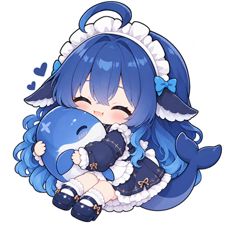

# @fish-under-sea/dsh-fish



**2.2.2 · Eleven plugins, one bundle**

[简体中文](README.md)

## Installation

```sh
dsh plugin --profile <profile> add @fish-under-sea/dsh-fish@2.2.2
```

Restart DSH after installation. With no desktop CLI, add the same package in the plugin manager. Requires Node `>=24.9`; minimum Host `0.2.2-rc.3`. Every member retains its own Host compatibility declaration.

## What's New

**2.2.2: light/dark distinction restored for the effort slider, with DeepSeek dark mode kept blue.**

- **2.2.2 colours**: the dark and light track, track-glow and radiation palettes are distinct again. DeepSeek in dark mode no longer uses the dark violet palette — it falls back to the same blue as light mode (track, progress fill, glow, knob and radiation all switch to blue); every other model family keeps its own dark theme.
- **2.2.2 text**: the model-row reasoning-effort text follows the active model theme; in dark mode DeepSeek takes the blue at the end of its blue track.
- **2.2.2 includes the 2.1.1 fix**: the `agent_teams_*` availability check resolves the optional native team-mode service through `ctx.get('agentTeams')` instead of reading `ctx.agentTeams`, so `cannot get property "agentTeams" without inject` can no longer break every team tool.
- **New DSH support**: all eleven members and the aggregate declare `dsh.engines.dsh` / peers / dev dependencies on `>=0.2.2-rc.3` / `^0.2.2-rc.3`.
- **AgentTeams upstream sync**: `dsh-agent-teams-fish` syncs upstream v0.1.30 for the 0.2.2-rc.2/rc.3 subagent tree manager and `subagent-settled.stopReason`.
- **Enable AgentTeam takeover**: the model/reasoning menu team switch is Fish-owned; the official team task tools and official team UI rows are disabled in the bundle layer.
- **Empty-input send dedupe**: Approval Guide allows only one successful write path and normalizes the editor to a single copy before submit.
- **Version**: all eleven members and the aggregate are **2.2.2**, with exact dependency pins.
- **Still unbundled**: Git Graph remains retired; Jailbreak still installs separately.

## Included Plugins

All 11 members are **2.2.2** and live in `packages/` here. The aggregate itself is **2.2.2**, with exact dependency pins.

| Plugin | npm | Capabilities |
| --- | --- | --- |
| Approval Guide | `@fish-under-sea/dsh-approval-guide` | Chinese action, risk and rationale explanations for approval prompts; empty-input Send auto-continues. |
| Git Sync | `@fish-under-sea/dsh-git-sync` | Previews, commits, pulls and restores selected DSH configuration through a private Git repository; credentials never travel through Git sync. |
| Settings Navigation | `@fish-under-sea/dsh-settings-nav-order` | Reorders and hides settings entries; orders the whole start-page command column with cross-machine restore; manages extension-command icons and localized titles. |
| Visual Companion | `@fish-under-sea/dsh-visual-companion` | Binds a visual-companion directory and delivers submitted selections and notes as a user message that wakes the target session. |
| Skill Lens | `@fish-under-sea/dsh-skill-lens-fish` | Lists, inspects, edits, creates, imports and deletes skills; graphs dependencies. |
| Task Board | `@fish-under-sea/dsh-client-ui-task-board-fish` | Host-authoritative task ledger, Kanban and subtasks; real session execution, cron and one-shot schedules, acceptance and team execution. |
| SSH Operations | `@fish-under-sea/dsh-ssh-fish` | Host inventory, pooled connections, Web PTY terminals, SFTP, port-forward tunnels and cluster execution. |
| Usage Monitor | `@fish-under-sea/dsh-usage-fish` | Token usage by provider and model, balances, quotas, peak/off-peak cost estimates and a sidebar summary. |
| Session Archive | `@fish-under-sea/dsh-session-archive-fish` | Central inventory, batch archive, guarded cascade deletion and automatic retention rules. |
| Reasoning Effort | `@fish-under-sea/dsh-better-reasoning-effort-fish` | Per-model reasoning effort and image-input declarations, backed by a model knowledge base and wire-protocol inference, editable in the model card. |
| AgentTeams | `@fish-under-sea/dsh-agent-teams-fish` | Natural-language teams, task DAGs, mailboxes, quality gates and repair rounds, durable recovery and vendor artwork. |

## Optional: install Jailbreak separately

Jailbreak `@fish-under-sea/dsh-purge-fish` is **not bundled**. Install it separately when needed. It injects replaceable cleanup prompts for every model, is configurable per model, and ships a red-team playground with one-click rollback.

```sh
dsh plugin --profile <profile> add https://github.com/Fish-under-sea/dsh-purge/archive/refs/heads/master.tar.gz
```

Its own `cordis.patch.yml` performs the host prompt rewrite; the bundle no longer does it. Row id `dsh-purge` and data directory `$DSH_HOME/redteam` are unchanged.

## Migrating from older releases

- Back up `$DSH_HOME`, the profile manifest and patches first; also back up any locally linked plugin sources.
- **Effort and AgentTeams are now bundle members**: if the profile installed `@fish-under-sea/dsh-better-reasoning-effort-fish` (0.5.x) or `@fish-under-sea/dsh-agent-teams-fish` (1.1.0) separately, remove that standalone install and its bundle row before upgrading to avoid double mounting. Package names, row ids and state directories are unchanged.
- **Git Graph is still not bundled**: install `@fish-under-sea/dsh-client-ui-git-graph-fish@1.0.2` separately if needed, never alongside the bundle.
- **Jailbreak is still standalone**: its four rows and `system-prompt` rewrite belong to its own package.
- Versions below `2.2.2` are marked deprecated on npm; install `@fish-under-sea/dsh-fish@2.2.2`.
- Upgrading the bundle does not remove standalone packages, bundles or override rows from the profile; review and remove old entries in the plugin manager before restarting.

## Coexistence and data

Do not enable the upstream `dsh-web-all` row together with Fish rows; different ids can still register the same service. Skill Lens shares the `skill-lens` row id with the upstream package, so never insert both. This bundle inserts only its own 11 rows, does not rewrite the host `system-prompt`, and does not disable legacy red-team rows. It does not change the host’s built-in titles.

Configuration and business data stay under `$DSH_HOME` or the workspace, never hard-coded to a machine path. SSH credentials may be stored in plain text; physical session deletion is irreversible; Git sync is not a full backup; schedules and team runs consume real model quota. See each member README for its security boundary.

## Development and sources

The following checks are manual, not release gates. A tag release only creates a GitHub Release; it does not build or test.

```sh
pnpm install --frozen-lockfile
pnpm test:release
pnpm -r --if-present typecheck
pnpm -r --if-present test
pnpm -r --if-present build
```

The aggregate itself is an empty entry; `cordis.patch.yml` is the mount point. All eleven members live in `packages/`, with `lib` committed, and remain independently buildable and publishable. Browser modules must be rebuilt under their actual package names. The aggregate and its members share version 2.2.2.

Fish-native: Approval Guide, Git Sync, Settings Navigation, Visual Companion. Fork sources:

- [x-feichen/dsh-skill-lens](https://github.com/x-feichen/dsh-skill-lens) · MIT
- [zhu1090093659/dsh-web](https://github.com/zhu1090093659/dsh-web) · Apache-2.0 (Git Graph retired upstream)
- [NanmiCoder/dsh-agent-teams](https://github.com/NanmiCoder/dsh-agent-teams) · MIT
- [HaoyueQin/dsh-better-reasoning-effort](https://github.com/HaoyueQin/dsh-better-reasoning-effort) · MIT
- [YuJunZhiXue/dsh-purge](https://github.com/YuJunZhiXue/dsh-purge) · MIT (upstream of the standalone Jailbreak package)

Original copyrights and each member’s LICENSE/NOTICE are retained. The aggregate entry is MIT. Historical changes live in [CHANGELOG](CHANGELOG.md).
