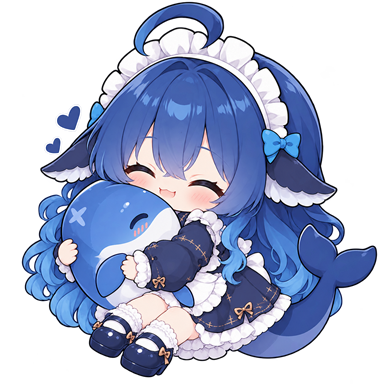

# @fish-under-sea/dsh-fish



**1.1.0 · Ten plugins, one bundle**

[简体中文](README.md)

## Installation

```sh
dsh plugin --profile <profile> add @fish-under-sea/dsh-fish@1.1.0
```

Restart DSH after installation. With no desktop CLI, add the same package in the plugin manager. Requires Node `>=24.9`; minimum Host `0.2.2-rc.1`. Every member retains its own Host compatibility declaration.

## What's New

**Adapted to DSH 0.2.2-rc.1, caught up with upstreams, and bumped to 1.1.0.**

- **Upstream sync**: Task Board, Session Archive, SSH Operations and Usage Monitor move to `zhu1090093659/dsh-web` v0.4.16; AgentTeams moves to `NanmiCoder/dsh-agent-teams` v0.1.29 (including member model fallback, quality-gate fixes and per-session activity polling). Skill Lens’s upstream `x-feichen/dsh-skill-lens` has had no new commits since 2026-09-03, so it keeps its current implementation and only receives Host adaptation.
- **Git Graph retired**: upstream `dsh-web` removed the `dsh-git-graph` plugin in v0.4.14, so this bundle retires it too and drops from 11 to 10 members. Users who still need Git Graph can keep `@fish-under-sea/dsh-client-ui-git-graph-fish@1.0.2`; it no longer upgrades with the bundle.
- **Host adaptation**: type dependencies and build targets move to `@deepseek-ai/* 0.2.2-rc.1`; `engines.node` rises to `>=24.9` (DSH 0.2.2’s minimum Node); each member’s `dsh.engines.dsh` and peer declaration move to `>=0.2.2-rc.1`.
- **Version**: all ten members and the aggregate are unified at **1.1.0**, with exact dependency pins.

Retained from the previous release: Settings Navigation owns icons, localized titles and ordering for four extension commands, defaulting to **Agent Teams → Visual Companion → Context Compression → Cache Statistics** (`agent-teams → companion → acp → acp-cache`). Jailbreak remains unbundled; install it separately as described below.

## Included Plugins

All 10 members are currently **1.1.0**, with exact dependency pins. Nine members live here; AgentTeams has its own repository. The aggregate itself is **1.1.0**.

| Plugin | npm | Capabilities |
| --- | --- | --- |
| [Approval Guide](https://www.npmjs.com/package/@fish-under-sea/dsh-approval-guide) | `@fish-under-sea/dsh-approval-guide` | Adds Chinese action, risk and rationale explanations to approval prompts for files, commands, network access and privilege changes. |
| [Git Sync](https://www.npmjs.com/package/@fish-under-sea/dsh-git-sync) | `@fish-under-sea/dsh-git-sync` | Previews, commits, pulls and restores selected DSH configuration through a private Git repository; exports only `$DSH_HOME/.credentials.yaml` locally to a user-selected or dynamically resolved Desktop folder, never through Git sync. |
| [Settings Navigation](https://www.npmjs.com/package/@fish-under-sea/dsh-settings-nav-order) | `@fish-under-sea/dsh-settings-nav-order` | Reorders and hides settings entries; manages four extension commands’ icons, localized titles, descriptions and persisted default order. |
| [Visual Companion](https://www.npmjs.com/package/@fish-under-sea/dsh-visual-companion) | `@fish-under-sea/dsh-visual-companion` | Binds a visual-companion directory and delivers submitted selections and notes as a user message that wakes the target session; exposes arm, disarm, status and wake. |
| [Skill Lens](https://www.npmjs.com/package/@fish-under-sea/dsh-skill-lens-fish) | `@fish-under-sea/dsh-skill-lens-fish` | Lists, inspects, edits, creates, imports and deletes skills; graphs dependencies, supports directory SKILL.md and flat .md skills plus shared references, and follows DSH_HOME. |
| [Task Board](https://www.npmjs.com/package/@fish-under-sea/dsh-client-ui-task-board-fish) | `@fish-under-sea/dsh-client-ui-task-board-fish` | Host-authoritative task ledger, Kanban and subtasks; real DSH session execution, recurring cron and one-shot schedules with run budgets, opt-in goals, acceptance, team execution and idle-sleep protection. |
| [SSH Operations](https://www.npmjs.com/package/@fish-under-sea/dsh-ssh-fish) | `@fish-under-sea/dsh-ssh-fish` | Host inventory, pooled connections, persistent Web PTY terminals, SFTP, loopback tunnels and cluster execution; six agent tools share the GUI host configuration. |
| [Usage Monitor](https://www.npmjs.com/package/@fish-under-sea/dsh-usage-fish) | `@fish-under-sea/dsh-usage-fish` | Tracks token usage by provider and model, balances, subscription quotas, peak/off-peak cost estimates, Token Bank and a sidebar summary. |
| [Session Archive](https://www.npmjs.com/package/@fish-under-sea/dsh-session-archive-fish) | `@fish-under-sea/dsh-session-archive-fish` | Central session inventory and filtering, batch archive/unarchive, guarded cascade physical deletion, and optional automatic archival and retention rules. |
| [AgentTeams](https://www.npmjs.com/package/@fish-under-sea/dsh-agent-teams-fish) | `@fish-under-sea/dsh-agent-teams-fish` | Approved member dispatch, task DAGs, mailboxes, quality gates and repair rounds, durable recovery, Fish vendor/role artwork, eighteen vendor identities and route-aware captain avatars. |

## Optional: install Jailbreak separately

Jailbreak (`@fish-under-sea/dsh-purge-fish`) is **not included in the bundle**. Install it on its own when wanted: it injects replaceable cleaning prompts for every model, configurable per model, and ships a red-team bench (presets, skills, SQLite fact store, HTTP bridge) plus one-click rollback.

Once it clears npm review, install it the usual way:

```sh
dsh plugin --profile <profile> add @fish-under-sea/dsh-purge-fish@1.0.4
```

Before that, install from the GitHub source:

```sh
dsh plugin --profile <profile> add https://github.com/Fish-under-sea/dsh-purge/archive/refs/heads/master.tar.gz
```

When installed standalone, its own `cordis.patch.yml` performs the host prompt rewrite (disables the harness identity section, clears `personaPrefix`, replaces `personaSuffix` with a non-interpolating sentence) and disables the five legacy red-team rows; the bundle no longer does any of this. The `dsh-purge` row id and the `$DSH_HOME/redteam` data directory are unchanged.

## Migration

- Securely back up `$DSH_HOME`, profile manifests and patches; separately back up local linked plugin source.
- **Git Graph leaves the bundle**: 1.1.0 no longer inserts the `ui-git-graph` row. After upgrading, remove any leftover row or override for it from the profile; if you still need Git Graph, install `@fish-under-sea/dsh-client-ui-git-graph-fish@1.0.2` separately and never mount it together with the bundle.
- AgentTeams is `@fish-under-sea/dsh-agent-teams-fish`. The `agent-teams` row id, `.agent-teams` state directory and configuration keys stay unchanged. Never mount old and new packages together.
- Jailbreak is no longer bundled as of 1.0.5: after upgrading, none of the four rows (`dsh-purge`, `dsh-purge-redteam`, `dsh-purge-redteam-store`, `dsh-purge-redteam-ui`) nor the `system-prompt` rewrite is injected by the aggregate any more. Add it via “Optional: install Jailbreak separately” when needed; otherwise nothing to do, and leftover profile overrides for those ids can simply be removed.
- Better Reasoning Effort is no longer bundled. Use `dsh-better-reasoning-effort` from [HaoyueQin upstream](https://github.com/HaoyueQin/dsh-better-reasoning-effort), not the Fish fork.
- Video Preview is discontinued. OFM and the retired session-title plugin are not included and have no replacement dependency here. This release does not delete existing user data.
- Updating the aggregate does not automatically remove old standalone dependencies, bundles or profile overrides. Review and remove those entries in the plugin manager before restarting.
- Version migration does not repair corrupted historical sessions. Do not delete log events as an upgrade step.

## Coexistence and Data

Do not co-enable equivalent upstream `dsh-web-all` and Fish rows: distinct ids can still register the same services twice. Upstream Skill Lens shares the `skill-lens` id. This bundle inserts only its own ten rows, no longer rewrites the host `system-prompt`, and no longer disables legacy red-team rows — those rewrites now belong to the standalone Jailbreak package. It never disables another package or the built-in title service.

Configuration and data stay in `$DSH_HOME` or the workspace without hard-coded machine paths. SSH credentials may be plaintext; physical session deletion is irreversible; Git sync is not a full backup; scheduling and teams consume real model quota. Read each member safety section.

## Development and Attribution

The following checks are optional manual commands, not commit or release gates. This repository has no push/PR verification workflow, and tag releases run neither builds nor tests. All in-repository packages share this policy; runtime permissions and data protection remain unchanged.

```sh
pnpm install --frozen-lockfile
pnpm test:release
pnpm -r --if-present typecheck
pnpm -r --if-present test
pnpm -r --if-present build
```

The aggregate has no runtime implementation: `cordis.patch.yml` mounts independently built and published members. Rebuild client modules for their real package identity. The aggregate version moves separately from member versions: 1.1.0 is the bundle’s own version, members stay pinned to their published versions, and no claim is made that every upstream HEAD is merged.

Fish-native: Approval Guide, Git Sync, Settings Navigation and Visual Companion. Fork sources:

- [x-feichen/dsh-skill-lens](https://github.com/x-feichen/dsh-skill-lens) · MIT
- [zhu1090093659/dsh-web](https://github.com/zhu1090093659/dsh-web) · Apache-2.0 (Git Graph was retired with upstream)
- [NanmiCoder/dsh-agent-teams](https://github.com/NanmiCoder/dsh-agent-teams) · MIT
- [YuJunZhiXue/dsh-purge](https://github.com/YuJunZhiXue/dsh-purge) · MIT (upstream of the standalone Jailbreak package; no longer part of this bundle)

Original copyrights, member LICENSE files and NOTICE files are preserved. The aggregate is MIT. Historical changes are in [Changelog](CHANGELOG.en.md).
