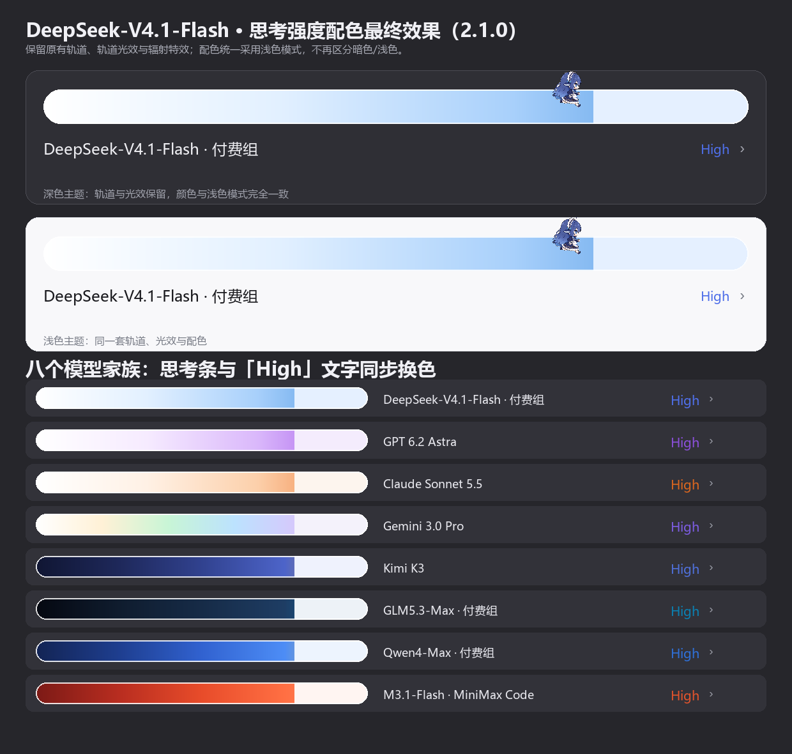
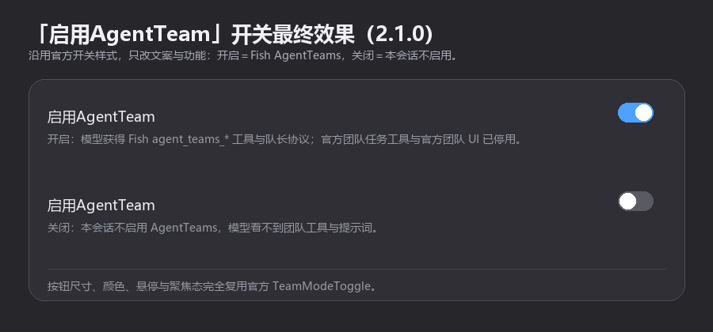

# dsh-fish 2.1.0 本轮变更与效果

> 结论先行：2.1.0 适配 DeepSeek Harness `0.2.2-rc.3`，同步 AgentTeams 上游 v0.1.30；「启用AgentTeam」开关改由 Fish 接管，官方团队任务工具与 UI 停用；思考强度配色明暗统一并让强度文字随模型主题换色；空输入自动发送不再重复写入同一句话。

## 1. 版本与上游适配

- 十一个成员与聚合包统一 `2.1.0`；`dsh.engines.dsh` 与 peer/dev 依赖提升到 `>=0.2.2-rc.3` / `^0.2.2-rc.3`。
- AgentTeams 同步上游 `NanmiCoder/dsh-agent-teams` v0.1.30：`harness-compat.ts` 与 `mailbox.ts` 与上游一致（另保留 Fish 的模型策略与队长路由扩展），覆盖 0.2.2-rc.2/rc.3 的 `deliverToMember`、`resident`/`dispose`、定向停止、冷恢复与 `subagent-settled.stopReason`。
- 四个 dsh-web 派生成员（任务看板、会话归档、SSH、用量）在 v0.4.16→v0.4.19 间没有承载源文件变更，按上游要求只同步版本声明；`pnpm-lock.yaml` 已更新。

## 2. 思考强度配色（最终效果）

- 保留原 `runner-styles.ts` 的轨道、轨道光效与辐射特效，仅把 `body:not([data-ds-dark-theme])` 这层明暗区分去掉：同一套浅色模式配色同时用于暗色与浅色主题。
- 八款模型家族各有 `--bre-accent`：模型行的「High」等强度文字随模型切换取对应思考条主色。
- 上图为按 `lib/client.js` 实际构建产物中的浅色模式轨道/进度渐变与色值渲染的示意图（渲染脚本仅读取同一组色值；本会话无法启动 DSH 桌面实机截图）。

## 3. 「启用AgentTeam」开关

- 在模型与推理菜单的 `conversation.input.model.options` 槽位注册 Fish 开关（同 id、优先级 `-1`，旧 profile 残留的官方项会被覆盖），文案为「启用AgentTeam」，尺寸/颜色/悬停/聚焦完全沿用官方 `TeamModeToggle`。
- 开启：本会话提供 Fish `agent_teams_*` 工具与队长协议；关闭：工具与提示词都不参与本会话。
- bundle 层停用官方 `tool-agent-team` 与 `ui-agent-team` 行；官方 `agent-team` 服务仅保留，用于持久保存每个 Session 的开关投影，避免两套团队协议冲突。

## 4. 空输入发送去重

- 审批说明的三级写入兜底改为「一次成功即返回」，不再在 execCommand、paste、DOM 三路各插一遍。
- 提交前把编辑器内容收敛为唯一一份；用 window 级安装标记防止热重载重复监听。

## 5. 验证记录

实际运行：

- `node --test --test-isolation=none scripts/release-contract.test.mjs`：7/7 通过。
- `node --test --test-isolation=none packages/dsh-approval-guide/test/guide.test.mjs`：27/27 通过（含新增的 execCommand 重复插入、paste 重复插入、重复 apply 三条去重回归）。
- `tsc --noEmit`：AgentTeams 宿主/客户端、effort、任务看板、会话归档、SSH、用量、技能中心全部 0 错误。
- AgentTeams 上游兼容脚本中 5 项仍按旧内核 mock 断言（rc.3 的 `SubagentRuntime` 构造与事件形状已变），未作为产品失败；上游 v0.1.30 已同步对应测试改写。
- Vitest 滑块测试在本地受限环境受 React 双实例（手工恢复 node_modules）影响未能完整跑通；已通过类型检查与构建产物静态检查（`check-styles.mjs` 通过、构建出的 `lib/client.js` 含新色值与 `data-bre-theme`）。
