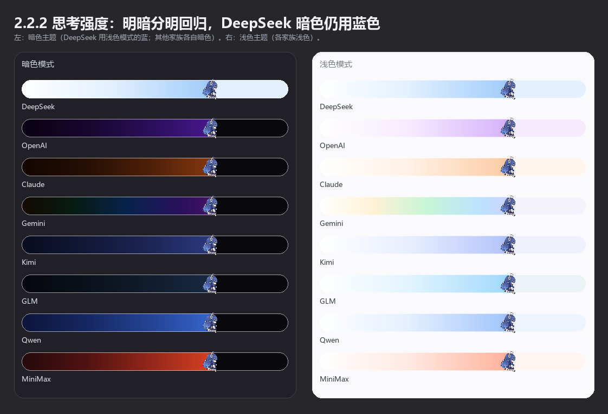

# dsh-fish 2.2.2 思考强度配色

> 结论先行：恢复暗色/浅色两套配色，其余模型家族回到各自的暗色主题；DeepSeek 在暗色模式下不再用深色紫调，改用浅色模式那条蓝色。

## 变更

- `runner-styles.ts` 还原 `body:not([data-ds-dark-theme])` 前缀（169 处），暗色与浅色的轨道、轨道光效、flare 与辐射特效重新区分。
- 新增 `body[data-ds-dark-theme] .bre-effort[data-bre-theme="deepseek"] …` 覆盖块：暗色模式下 DeepSeek 复用浅色模式的蓝色轨道、进度填充、光效、滑块与呼吸动画；选择器限定 `deepseek`，家族主题不受影响。
- `radiation.ts`：`isDark = theme !== 'deepseek' && document.body.hasAttribute('data-ds-dark-theme')`，DeepSeek 恒用浅色模式色板。
- `styles.ts`：暗色模式下 DeepSeek 的 `--bre-accent` 取同一蓝色轨道末端的 `#5aa6f0`。

## 效果

左列为暗色主题：DeepSeek 为蓝色（与浅色模式同一条轨道），OpenAI / Claude / Gemini / Kimi / GLM / Qwen / MiniMax 各自恢复暗色配色。右列为浅色主题，与上一版一致。

## 验证

- `check-styles.mjs`：两个样式字面量无游离反引号。
- `tsc -p tsconfig.json --noEmit`：0 错误。
- 构建产物 `lib/client.js` 已包含 `body[data-ds-dark-theme] .bre-effort[data-bre-theme="deepseek"]` 覆盖块、暗色 accent 与 `theme !== 'deepseek'` 判定，并保留 `body:not([data-ds-dark-theme])` 浅色块。
