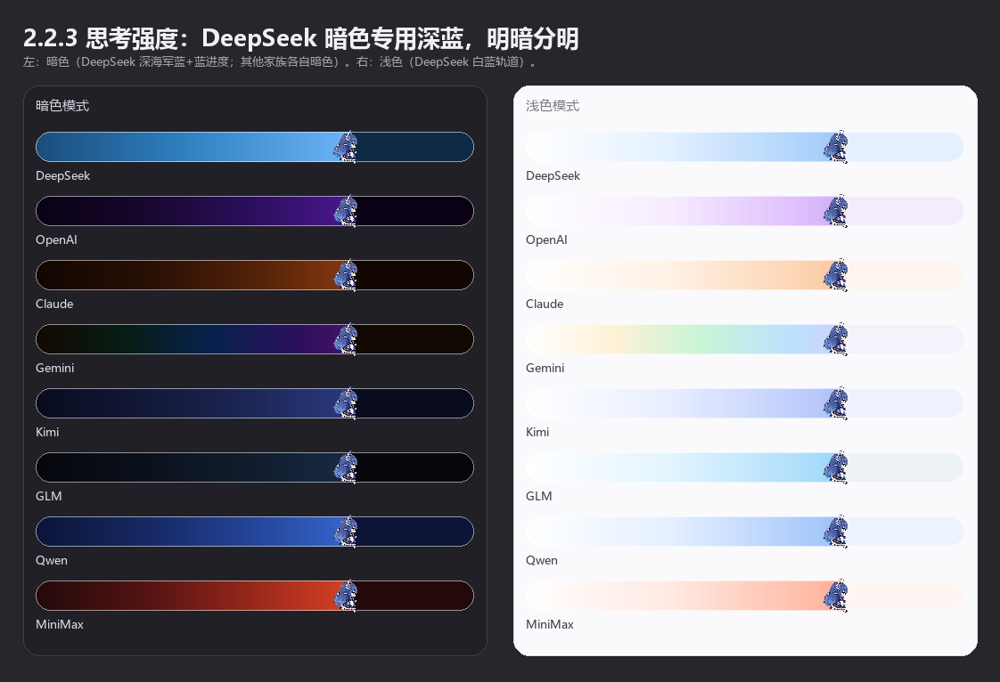

# dsh-fish 2.2.3

> 结论先行：适配 DSH `0.2.2-rc.4`（补顶层 `engines.dsh`，否则整行 `agent-teams` 被禁用、开关消失）；DeepSeek 暗色改成专门的深蓝配色，明暗仍分明。

## 1. 适配 DSH 0.2.2-rc.4

DSH 的 `@deepseek-ai/dsh-app-boot` 用 `plugin-compatibility` 判定插件是否可用，只读**顶层** `engines.dsh`：

```ts
const engines = fields.engines ?? {}
if (Object.hasOwn(engines, 'dsh')) return satisfies(runtime, engines.dsh) ? {} : { 'engines.dsh': ... }
// 没有顶层 engines.dsh 时，退化为逐个 @deepseek-ai peer 比对
```

此前本仓库只有嵌套的 `dsh.engines.dsh`，于是判定走了 peer 列表；`0.2.2-rc.4` 不在枚举里，启动日志出现：

```text
dsh: disabling profile plugin row "agent-teams": Plugin @fish-under-sea/dsh-agent-teams-fish@2.2.2
is incompatible with dsh 0.2.2-rc.4: requirements { ... }
```

整行被禁用后，AgentTeams 的 host 半区与浏览器半区都不再加载，模型菜单里的「启用AgentTeam」开关随之消失。

修复：

- 十二个 package.json 全部补 `"engines": { "node": ">=24.9", "dsh": ">=0.2.2-rc.3 <0.3.0" }`；
- `@deepseek-ai` 系 peer 统一为 `^0.2.2-rc.3`；
- `compatibility.json` 推荐宿主改为 `0.2.2-rc.4`；
- 新增 `scripts/compatibility-tdd.mjs`：按 DSH 相同方式（`semver.satisfies(..., { includePrerelease: true })`）断言接受 `rc.3 / rc.4 / rc.5 / 0.2.2 / 0.2.3-alpha`，拒绝 `rc.2 / 0.2.1-rc.2 / 0.3.0 / 1.0.0`。

## 2. DeepSeek 暗色专门配色



- 暗色：轨道 `#0e2a47`，进度 `#1a4d7c → #2f7fbf → #63acf0 → #a8d0fb`，蓝色 flare / 滑块 / 呼吸动画；原来的紫调全部移除。
- 浅色：保持 `#e5f0ff` 轨道与 `#fff → #438fdf` 进度。
- 其他模型家族：暗色与浅色继续各自一套（OpenAI 紫、Claude 橙、Gemini 光谱、Kimi 靛蓝、GLM 青、Qwen 蓝金、MiniMax 珊瑚）。
- 思考强度文字随模型主题换色，暗色 DeepSeek 取 `#6cb6ff`。

## 3. 验证

- `node --test scripts/release-contract.test.mjs`：7/7
- `node --test scripts/compatibility-tdd.mjs`：5/5（新增）
- 审批说明：27/27；AgentTeams 模式回归：3/3
- effort `check-styles.mjs` 通过，`tsc --noEmit` 0 错误
- effort 客户端已重建，产物含暗色 DeepSeek 覆盖块、暗色 accent、明暗两套色板
