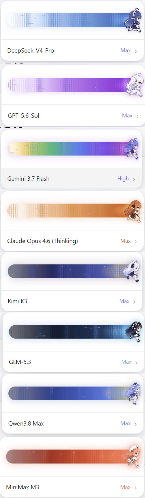
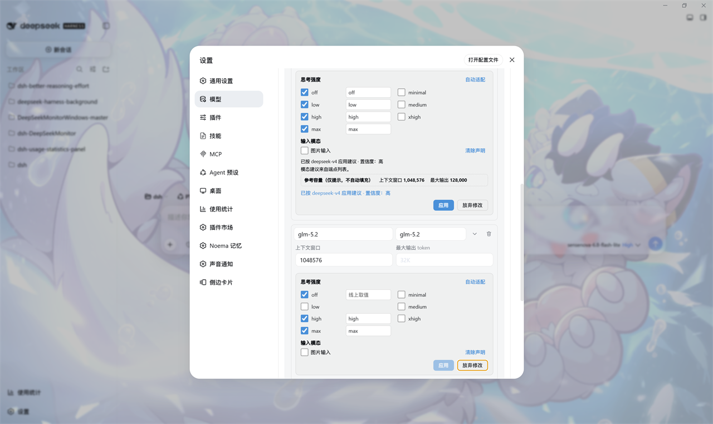

<div align="center">

# dsh-better-reasoning-effort-fish

**Edit reasoning effort and input modalities for third-party models right inside the official Models page card in DSH**

[](https://www.npmjs.com/package/@fish-under-sea/dsh-better-reasoning-effort-fish)


[简体中文](README.md) · **English**

</div>

> **2.0.2: this package now lives in the [`dsh-fish`](https://github.com/Fish-under-sea/dsh-fish) monorepo as the `packages/dsh-better-reasoning-effort-fish` workspace member, built and released together with the aggregation package `@fish-under-sea/dsh-fish` 2.0.2.** Features are the upstream v0.5.4 sync plus the eight runner themes. See [Installation](#installation) for install and upgrade commands. Browser interaction and real-DSH verification are still pending; see [Development & Testing](#development--testing).

## Original Author & Attribution (Please Read First)

| Item | Details |
|------|---------|
| Plugin name | **dsh-better-reasoning-effort** — declares reasoning effort and input modalities for third-party models |
| Original author | **HaoyueQin** · GitHub [@HaoyueQin](https://github.com/HaoyueQin) |
| Original repository | <https://github.com/HaoyueQin/dsh-better-reasoning-effort> |
| Upstream npm package | `dsh-better-reasoning-effort` (**belongs to the original author; this fork cannot reuse the name**) |
| This fork's npm package | **`@fish-under-sea/dsh-better-reasoning-effort-fish`** |
| Location since 2.0.2 | [`packages/dsh-better-reasoning-effort-fish`](https://github.com/Fish-under-sea/dsh-fish/tree/main/packages/dsh-better-reasoning-effort-fish) in the [`dsh-fish`](https://github.com/Fish-under-sea/dsh-fish) monorepo, built and released with the other members |
| License | **MIT**; upstream [`LICENSE`](LICENSE) is unmodified; see [`NOTICE.md`](NOTICE.md) for the visual source's separate MIT notice |
| Fork baseline | [HaoyueQin/dsh-better-reasoning-effort](https://github.com/HaoyueQin/dsh-better-reasoning-effort) `master` = **v0.5.4** (commit [`2d68b65cc641cd85e95384c859a2bc3de23d9e08`](https://github.com/HaoyueQin/dsh-better-reasoning-effort/commit/2d68b65cc641cd85e95384c859a2bc3de23d9e08); synced from v0.5.2 `52b584c`) |
| Nature of this fork | **Personal customization (fork)** — neither original nor official; from 2.0.2 the source is maintained in the `dsh-fish` monorepo, while the standalone repository keeps only the 0.5.x release history; the upstream README is preserved intact as [`README.original.md`](README.original.md) / [`README_ZH.original.md`](README_ZH.original.md) |

> Full details on attribution and the scope of changes are in [`NOTICE.md`](NOTICE.md). Please preserve the original author's credit when redistributing.

## What Problem Does This Solve

The `llm-pi-ai` adapter natively supports per-model `reasoningEfforts` and `input` declarations, but the official Models page editor deliberately keeps both fields out of reach. As a result, third-party models get **no thinking-level picker** in the Composer — only the official DeepSeek API can set reasoning effort, hand-declared models are treated as **text-only**, and configuring any of this meant hand-writing `settings.yaml` blocks.

This plugin brings both configuration surfaces back into the UI: edit them inside the official model editor card, with one-click auto-adapt (built-in model knowledge base + wire-protocol inference).

| Capability | Description |
|------------|-------------|
| **In-page editor** | An "Options" block appears in each model row's disclosure on the official Models page (reasoning effort, input modalities, endpoint compatibility); changes commit with the card's own **Save** and are discarded together on **Cancel** |
| **Auto-adapt** | One click fills recommended levels, wire spellings and modalities: built-in knowledge base (65 entries across 15 vendors) + wire-protocol inference + same-origin `/models` probe; every suggestion is labeled by confidence |
| **Auto-fill** | At boot and when models are added, only curated official knowledge-base matches are filled automatically; unknown models stay unchanged until the user accepts Auto-adapt (disable with `autofill: false` / `modalityAutofill: false`); explicit declarations, `false`, and deliberately-unset markers are preserved |
| **Catalog-safe writes** | Routes using DSH's official `modelOverrides` retain their installed catalog; only the edited model override is written |
| **Three intents** | All levels off = unset (back to inheritance); only `off` checked = disable reasoning; levels armed = write the declaration |
| **Composer effort slider** | The official model menu popup becomes an eight-theme runner slider (drag / keyboard, optimistic commit with rollback), with a model row opening the official model list; the bottom-right trigger stays untouched. Model switches retain per-session effort memory, while per-model defaults take priority across sessions |
| **Per-model default effort** | A "Default effort" picker on each model row, stored in the settings document; every new session starts the model at that level |
| **Request headers & User-Agent** | Edit the official `headers` field inside the provider card (masked display, path-merged), with per-origin fetch-layer `user-agent` takeover; same-origin `/models` probes are covered |
| **Defensive injection** | Everything keys off the official page's DOM; if an official upgrade changes the structure, injection pauses automatically — the official page is unaffected |

**This fork preserves its separate package name, plugin id, host routes, and slot-free provider-card DOM injection fix. On top of upstream v0.5.4, it adds eight model-family runner themes enabled by default.** See [Runner Themes](#runner-themes) and [Compatibility & Boundaries](#compatibility--boundaries).

## Runner Themes

- **Eight themes**: DeepSeek / OpenAI / Claude / Gemini / Kimi / GLM / Qwen / MiniMax. Model `id` / `name` takes precedence, provider is the fallback, and unrecognized models use DeepSeek; an aggregator's name does not override a recognized model family.
- **No extra toggle**: characters are enabled by default within the Composer slider, reusing its existing switch and `dsh-better-reasoning-effort.slider.enabled` preference key. Users who disabled the slider keep it disabled; nothing forcibly re-enables it, and no character-only setting is added.
- **Light/dark and motion**: matching light/dark tracks, sprite-based running and radiation effects; dragging accelerates the runner and boosts the effects. `prefers-reduced-motion: reduce` uses a static presentation while keeping effort selection available.
- **Embedded assets**: esbuild's `dataurl` loader embeds the eight runtime PNGs in `lib/client.js`, with no additional asset route. Themes affect presentation only, not model capabilities or the reasoning-effort protocol.
- **Source**: [HanaAyane/dsh-reasoning-effort PR #9](https://github.com/HanaAyane/dsh-reasoning-effort/pull/9), contributed by [xihucuyudaichi](https://github.com/xihucuyudaichi), pinned to commit [`651d24edc1ff45fbce5339700b40f32c5ff3ddea`](https://github.com/HanaAyane/dsh-reasoning-effort/commit/651d24edc1ff45fbce5339700b40f32c5ff3ddea). The full MIT license is retained at [`assets/third-party/dsh-reasoning-effort.LICENSE`](assets/third-party/dsh-reasoning-effort.LICENSE); see [`NOTICE.md`](NOTICE.md) for attribution.

## Preview

<p align="center">
  
</p>

> **This is the asset PR's reference preview, not a real DSH runtime screenshot of this plugin.** The existing editor illustrations are retained below; these changes have not been verified in a real DSH instance.

<p align="center">
  <picture>
    <source media="(prefers-color-scheme: dark)" srcset="docs/banner-zh-dark.svg">
    
  </picture>
</p>

<p align="center">
  
</p>

## Installation

Since 2.0.2 this package follows the rest of the monorepo: DSH **≥ 0.2.2-rc.1**, with peer and development dependencies at `^0.2.2-rc.1`; Node **≥ 24.9**. **Dependency alignment does not mean this release has been verified on every DSH version.**

### Aggregation package (recommended)

```sh
# Desktop
dsh plugin --profile desktop add @fish-under-sea/dsh-fish@2.0.2

# Web
dsh plugin --profile web add @fish-under-sea/dsh-fish@2.0.2
```

The aggregation package pins all ten members to exact versions, so installing it brings every plugin released alongside this one. If you only need this plugin, install it on its own:

```sh
dsh plugin --profile web add @fish-under-sea/dsh-better-reasoning-effort-fish@2.0.2
```

DSH's bundled pnpm uses a 24-hour `minimum-release-age`, so unpinned installs may temporarily resolve to an older release; pinning bypasses that wait. **Restart DSH** and hard-refresh the browser after installation.

### Monorepo source (development)

This package lives in the `dsh-fish` monorepo and its `lib/` is committed, so a clone installs without a build. Rebuild and link it after changing sources:

```sh
git clone https://github.com/Fish-under-sea/dsh-fish.git
cd dsh-fish && pnpm install
pnpm --filter @fish-under-sea/dsh-better-reasoning-effort-fish build
dsh plugin --profile desktop add link:$PWD/packages/dsh-better-reasoning-effort-fish
# Or the Web profile
dsh plugin --profile web add link:$PWD/packages/dsh-better-reasoning-effort-fish
```

Source edits do not update the npm package. After rebuilding locally, restart DSH and hard-refresh the browser.

## Usage

1. Configure a third-party provider (API key, etc.) on the official Models page.
2. Expand a model row: the editor block sits below the official capacity fields.
   - Check levels (off / minimal / low / medium / high / xhigh / max) and fill wire values (e.g. give `high` the spelling `ultra` — the gateway receives `ultra` when you pick High in the Composer);
   - Toggle **Image input** under *Input modalities* to declare what the model accepts;
   - Click **Auto-adapt** to fill recommended levels and modalities — reference capacities appear as read-only hints you can copy into the official fields;
   - Changes are **pending** immediately and land when you press the card's own **Save**; **Cancel** (or a reload) discards them along with the card's fields.
3. On a compatible protocol, an *Endpoint compatibility* section appears at the bottom — thinking budget field / vLLM priority on `openai-completions`, `max_output_tokens` handling on `openai-responses`.
4. Request headers: expand the **provider card**; the header area sits above the editor block (masked display, saved with the card) — fill in `user-agent` and other custom headers.
5. All levels off + Save = unset the declaration (back to inheritance); only `off` checked + Save = disable reasoning (`false`); *Clear declaration* on the modality row + Save = back to inheriting the provider default.

Declared models are immediately selectable for reasoning effort in the Composer; models with image input declared accept attachments end to end.

## Configuration

The host side accepts the following optional config keys (written to the plugin's `config` block in `settings.yaml`):

| Key | Default | Values | Description |
|-----|---------|--------|-------------|
| `autofill` | `true` | `true` / `false` | At boot and when added, auto-fill only undeclared models matching the curated official knowledge base |
| `modalityAutofill` | `true` | `true` / `false` | Whether the boot fill also covers input-modality declarations |
| `probeTimeoutMs` | `15000` | positive integer | `/models` probe request timeout (ms) |
| `bootRetryDelaysMs` | `[1000, 2000, 4000, 8000, 16000, 30000]` | positive integer array | Retry delays after boot auto-fill failures (ms) |
| `defaultGuard` | `true` | `true` / `false` | Map effort-less calls on forced-thinking ladders to the vendor default instead of sending `thinking: disabled`; respect route-level `reasoning` defaults |
| `uaOverride` | `true` | `true` / `false` | Apply configured `user-agent` overrides per origin; set `false` to leave this layer to another rewriter |

Example:

```yaml
- insert:
    - id: dsh-better-reasoning-effort-fish
      name: '@fish-under-sea/dsh-better-reasoning-effort-fish'
      config:
        autofill: true
        modalityAutofill: true
        probeTimeoutMs: 15000
        bootRetryDelaysMs: [1000, 2000, 4000, 8000, 16000, 30000]
        defaultGuard: true
        uaOverride: true
```

## Compatibility & Boundaries

**This fork retains its existing compatibility fix**: the request-header editor no longer occupies the official `settings.models.provider-card` slot — it mounts on the card's own editor container instead. Together with the upstream v0.5.4 sync and runner-theme port, this is no longer a single-fix fork.

The reason: the official slot is a **keyed slot** — the registry accepts only one entry per `(key, priority)` pair, and a second registration throws. The dsh-web suite's `@linxin666/dsh-client-ui-model-capabilities` (model-capabilities panel) registers the same `llm-pi-ai` key at the same default priority `0`. When both plugins occupy the slot, only one registers successfully; the other's entire UI **silently disappears**. Because dsh-web loads via an async shell row, the loser is the **model-capabilities panel** (per-model reasoning effort / image input).

| | Before fix | After fix |
|---|---|---|
| `settings.models.provider-card` slot | Occupied by this plugin | **Fully yielded to `model-capabilities`** |
| Model-capabilities panel | May silently disappear on registration conflict | No longer competes with this plugin for the slot (not reverified in real DSH for this change) |
| Request-header editor | In the card (occupying the slot) | **Still in the card** — mounted on the card's own editor container |

Changes land in [`src/client/injection/provider-card.ts`](src/client/injection/provider-card.ts) (new), [`src/client/index.ts`](src/client/index.ts) (no longer registers the slot), and [`src/client/injection/models-page.ts`](src/client/injection/models-page.ts) (wired into page scanning). Regression guards live in [`tests/client.spec.tsx`](tests/client.spec.tsx) and [`tests/provider-card.spec.tsx`](tests/provider-card.spec.tsx).

The two plugins have separate plugin ids, host route prefixes (`/dsh-better-reasoning-effort-fish/*`), and package names — they can coexist in one profile. In practice, **install only one** to avoid the same settings being edited by two UIs simultaneously.

The Composer slider is **adapted from [HanaAyane's dsh-reasoning-effort](https://github.com/HanaAyane/dsh-reasoning-effort)** (MIT). If you used that plugin, remove it first to avoid two effort controls on the same seat:

```sh
dsh plugin --profile web remove dsh-reasoning-effort
```

**Known limitations**

- Injection depends on the official Models page's DOM (aria-label / class); an official upgrade may pause injection until adapted — the official page is unaffected meanwhile.
- The auto-adapt probe route answers **loopback and IP-literal hosts only**, and **never follows redirects** — a gateway listing its models only behind a 30x yields no endpoint evidence; auto-adapt falls back to the knowledge base and protocol inference.
- `reasoningEfforts` declarations are suggestions — what an endpoint actually accepts is up to its docs; tweak in the UI.
- Endpoint-compatibility switches are never auto-filled by design: they describe gateway behavior, not model capabilities.
- The modality vocabulary follows pi-ai's core (`text` / `image` today); wider gateway support (PDF / audio / video) cannot be declared until the core vocabulary grows — this is by design.
- Name-heuristic modality advice (vision-flavored ids) is deliberately labeled low-confidence; verify before relying on it.
- Self-hosted relays: auto-fill pins `supportsDeveloperRole: false` on routes no official host claims; explicit values are never overwritten.
- Forced-thinking models (ladders without `off`, e.g. GLM-5.3): effort-less calls map to the vendor default instead of sending `thinking: disabled` — set `defaultGuard: false` to restore raw behavior. If a route already declares a `reasoning` default, the official adapter resolves `options.reasoningEffort ?? profile.reasoning`; the guard steps aside rather than overriding that default.
- The default guard reports rewritten-call counts and the most recent model in the request-header section; the same report is available at this fork's `/dsh-better-reasoning-effort-fish/headers-config`, distinguishing an installed-but-idle guard from an active one.
- Unknown models are not auto-filled. Auto-adapt may still offer a low-confidence suggestion for explicit user review. Runner-family detection is a naming heuristic, not capability detection; falling back to the DeepSeek theme does not classify a model as DeepSeek.
- Motion depends on browser Canvas / animation support; reduced-motion uses static characters and effects. The reference preview does not establish the final layout across DSH versions, and these changes have not been verified in a real DSH instance.
- **Credentials inside `headers` are not redacted on disk**: the read-only view masks them, but the settings document still holds them in clear text — treat it like an API key.
- **The request-header section depends on the official card's editor container**: if the official build changes that structure, the section stops appearing — it never breaks the page. This is the fork's tradeoff vs. upstream: no slot occupancy, in exchange for coexistence with dsh-web plugins.
- **Only one `user-agent` rewrite should be active**: sibling header plugins land on the same layer; the last writer wins. The plugin detects and reports known siblings but cannot cover unknown cases.
- The request-layer takeover relies on the official adapter creating a fresh SDK client per request — an end-to-end test guards this boundary and fails loudly if it changes.

See [`docs/compatibility-notes.md`](docs/compatibility-notes.md) for more compatibility details, and [`docs/supported-models.md`](docs/supported-models.md) for the supported-models list.

## Development & Testing

Local checks when the package was merged into the monorepo for 2.0.2 (Node 24.14.0): `npm run typecheck` and `npm run build` passed; the `lib/` artifacts are committed, so a clone packs and publishes without a build. Browser interaction and real-DSH verification are still unverified; these release notes do not treat dependency alignment or asset previews as runtime evidence.

```sh
npm run typecheck   # tsc strict check
npm test            # vitest: knowledge base / inference / autofill / DOM injection / writing
npm run build       # lib/*.js + lib/client.js
```

Tests are vitest-driven and use the dependencies installed by `pnpm install` at the monorepo root; `lib/` is a committed build artifact — rebuild it with `npm run build` when needed.

When developing under the DSH file sandbox, `vitest` cannot load its vite config and esbuild cannot start its service (the sandbox blocks subprocess pipes) — run the suite in a normal terminal; see [`FORK.md`](FORK.md) for build notes.

## Relationship to the Aggregation Package

Since 2.0.2 this package lives in the [`dsh-fish`](https://github.com/Fish-under-sea/dsh-fish) monorepo and is built and released with the other members; the aggregation package [`@fish-under-sea/dsh-fish`](https://github.com/Fish-under-sea/dsh-fish) pins it at an exact version, and it can also be installed on its own as described in [Installation](#installation). The former standalone repository (<https://github.com/Fish-under-sea/dsh-better-reasoning-effort-fish>) keeps only the 0.5.x tags and published versions and is no longer updated; upgrade to 2.0.2.

## License

[MIT](LICENSE), retaining the upstream copyright notice for **HaoyueQin**. Runner assets and ported code also retain **HanaAyane**'s MIT notice, with credit to contributor **xihucuyudaichi**; these are not Fish-original work. New fork code is also provided under MIT. Preserve [`LICENSE`](LICENSE), [`NOTICE.md`](NOTICE.md), and [`assets/third-party/dsh-reasoning-effort.LICENSE`](assets/third-party/dsh-reasoning-effort.LICENSE) when redistributing.
