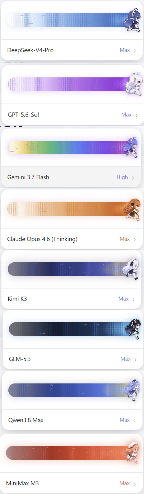
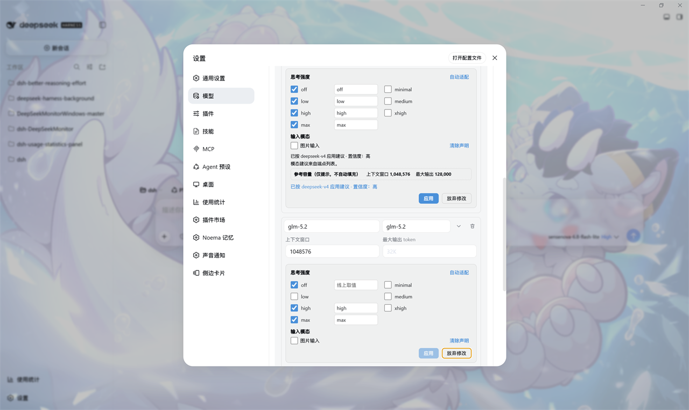

<div align="center">

# dsh-better-reasoning-effort-fish

**第三方模型的思考强度与输入模态，直接改在官方「模型」页的编辑卡里**

[](https://www.npmjs.com/package/@fish-under-sea/dsh-better-reasoning-effort-fish)


**简体中文** · [English](README.en.md)

</div>

> **2.0.0：本包已并入 `dsh-fish` 单仓，作为 `packages/dsh-better-reasoning-effort-fish` 工作区成员随聚合包 [`@fish-under-sea/dsh-fish`](https://github.com/Fish-under-sea/dsh-fish) `2.0.0` 一同构建与发布。** 功能为上游 v0.5.4 同步与八款大肥鱼主题；安装与升级方式见[安装](#安装)。浏览器交互与真实 DSH 运行验证仍待补充，详见[开发与测试](#开发与测试)。

## 原作者与授权（请先读）

| 项目 | 内容 |
|------|------|
| 插件名 | **dsh-better-reasoning-effort** —— 为第三方模型声明思考强度与输入模态 |
| 原作者 | **HaoyueQin** · GitHub [@HaoyueQin](https://github.com/HaoyueQin) |
| 原仓库 | <https://github.com/HaoyueQin/dsh-better-reasoning-effort> |
| 上游 npm 包名 | `dsh-better-reasoning-effort`（**归原作者，本版不能沿用**） |
| 本版 npm 包名 | **`@fish-under-sea/dsh-better-reasoning-effort-fish`** |
| 本版位置 | [`dsh-fish`](https://github.com/Fish-under-sea/dsh-fish) 单仓的 [`packages/dsh-better-reasoning-effort-fish`](https://github.com/Fish-under-sea/dsh-fish/tree/main/packages/dsh-better-reasoning-effort-fish)，与其余成员同批构建、同版本发布 |
| 许可证 | **MIT**；上游 [`LICENSE`](LICENSE) 未修改，视觉来源的独立 MIT 声明见 [`NOTICE.md`](NOTICE.md) |
| 本版基线 | [HaoyueQin/dsh-better-reasoning-effort](https://github.com/HaoyueQin/dsh-better-reasoning-effort) `master` = **v0.5.4**（commit [`2d68b65cc641cd85e95384c859a2bc3de23d9e08`](https://github.com/HaoyueQin/dsh-better-reasoning-effort/commit/2d68b65cc641cd85e95384c859a2bc3de23d9e08)；由 v0.5.2 `52b584c` 同步） |
| 本版性质 | **个人客制化版（fork）**，非原创、非官方；2.0.0 起源码随 `dsh-fish` 单仓维护，历史独立仓库只保留 0.5.x 的发布记录；上游 README 完整保留为 [`README.original.md`](README.original.md) / [`README_ZH.original.md`](README_ZH.original.md) |

> 署名与改动范围的完整说明见 [`NOTICE.md`](NOTICE.md)。再分发时请保留原作者署名。

## 解决什么问题

`llm-pi-ai` 适配器原生支持每模型声明 `reasoningEfforts`（思考强度）与 `input`（输入模态），但官方「模型」页编辑卡刻意不暴露这两个字段。结果：第三方模型在 Composer 里**没有思考档位选择器**，只有官方 DeepSeek API 能设思考强度，手工声明的模型被当作**纯文本**，想配置只能手写 `settings.yaml` 块。

本插件把这两份配置能力搬回 UI：在官方模型编辑卡内直接编辑，加一键自动适配（内置模型知识库 + 线协议推断）。

| 能力 | 说明 |
|------|------|
| **官方页内注入** | 官方模型行展开区出现「选项」编辑块（思考强度、输入模态、端点兼容），随卡片自身的**保存**统一提交，**取消**则一起丢弃 |
| **自动适配** | 一键填入推荐档位、线上取值与模态：内置知识库（15 家厂商 65 个条目）+ 线协议推断 + 同源 `/models` 探测，每条建议标注置信度 |
| **自动填充** | 启动及会话中新增模型时，仅自动补齐命中精选官方知识库的模型；未知模型保持不变，须用户确认「自动适配」建议（`autofill: false` / `modalityAutofill: false` 可关）；显式声明、`false` 与刻意撤销的标记不覆盖 |
| **目录安全写入** | 使用 DSH 官方 `modelOverrides` 的路由保留已安装目录，只写被编辑模型的 override |
| **三种意图** | 全不勾 = 取消声明（回到继承）；只勾 off = 禁用推理；勾选档位 = 写入声明 |
| **Composer 思考强度滑块** | 官方模型菜单弹出体换成带八主题角色的档位滑块（拖动 / 键盘，乐观提交、被拒回滚），保留模型条目打开官方模型列表，右下角触发钮保持原样；切换模型沿用会话档位记忆，每模型默认档跨会话优先 |
| **每模型默认思考强度** | 模型行上的「默认思考强度」选择器，写进设置文档，新会话打开该模型即用它 |
| **请求头与 User-Agent** | 提供商卡片内编辑官方 `headers` 字段（掩码显示、路径合并），并按 origin 精确接管 fetch 层的 `user-agent`；同源 `/models` 探测一并覆盖 |
| **防御式注入** | 一切锚定官方页 DOM；官方升级改变结构时注入自动暂停，官方页不受影响 |

**本 Fork 保留独立包名、插件 id 与 host 路由，以及不占用 `settings.models.provider-card` 的 DOM 注入兼容修复；在上游 v0.5.4 功能之上，新增默认启用的八模型家族奔跑角色主题。** 详见[角色主题](#角色主题)与[兼容与边界](#兼容与边界)。

## 角色主题

- **八款主题**：DeepSeek / OpenAI / Claude / Gemini / Kimi / GLM / Qwen / MiniMax。模型 `id` / `name` 优先识别，无法识别时回退 provider，仍未知则使用 DeepSeek；聚合供应商不会盖过已识别的模型家族。
- **无需额外开关**：角色在 Composer 滑块中默认启用，沿用整个滑块原有开关与 `dsh-better-reasoning-effort.slider.enabled` 偏好键；已关闭滑块的用户仍保持关闭，不强制重开，也没有新增角色专用设置。
- **深浅色与动效**：配套深色 / 浅色轨道、角色逐帧奔跑与辐射效果；拖动时奔跑加速、效果增强。`prefers-reduced-motion: reduce` 下使用静态呈现，仍可选择档位。
- **资源内嵌**：八张运行用 PNG 由 esbuild 的 `dataurl` loader 内嵌进 `lib/client.js`，无需额外资源路由；主题仅改变展示，不增加模型能力或改变思考强度协议。
- **来源**：[HanaAyane/dsh-reasoning-effort PR #9](https://github.com/HanaAyane/dsh-reasoning-effort/pull/9)，贡献者 [xihucuyudaichi](https://github.com/xihucuyudaichi)，固定 commit [`651d24edc1ff45fbce5339700b40f32c5ff3ddea`](https://github.com/HanaAyane/dsh-reasoning-effort/commit/651d24edc1ff45fbce5339700b40f32c5ff3ddea)。完整 MIT 许可保留在 [`assets/third-party/dsh-reasoning-effort.LICENSE`](assets/third-party/dsh-reasoning-effort.LICENSE)，完整署名见 [`NOTICE.md`](NOTICE.md)。

## 效果

<p align="center">
  
</p>

> **这是素材 PR 的参考预览，不是本插件在真实 DSH 中运行的截图。** 下方保留既有编辑器示意；本次改动尚未在真实 DSH 中验证。

<p align="center">
  <picture>
    <source media="(prefers-color-scheme: dark)" srcset="docs/banner-zh-dark.svg">
    
  </picture>
</p>

<p align="center">
  
</p>

## 安装

2.0.0 起本包与单仓其余成员对齐：DSH 要求 **≥ 0.2.2-rc.1**，`package.json` 的 peer 与开发依赖都是 `^0.2.2-rc.1`；Node 要求 **≥ 24.9**。**依赖对齐不表示本版已在所有 DSH 版本中验证。**

### 聚合包（推荐）

```sh
# 桌面版
dsh plugin --profile desktop add @fish-under-sea/dsh-fish@2.0.0

# Web 版
dsh plugin --profile web add @fish-under-sea/dsh-fish@2.0.0
```

聚合包以精确版本固定十个成员，安装它即得到与本包同批发布的其余插件。只需要这一个插件时，也可以单独安装：

```sh
dsh plugin --profile web add @fish-under-sea/dsh-better-reasoning-effort-fish@2.0.0
```

DSH 内置 pnpm 的 `minimum-release-age` 为 24 小时，不指定版本时可能暂时解析到更旧的版本；指定版本可跳过该等待。安装后**重启 DSH** 并强制刷新浏览器。

### 单仓源码（开发）

本包在 `dsh-fish` 单仓内，`lib/` 已随仓库提交，克隆后无需构建即可安装。改动源码后按下面的方式重建并链接：

```sh
git clone https://github.com/Fish-under-sea/dsh-fish.git
cd dsh-fish && pnpm install
pnpm --filter @fish-under-sea/dsh-better-reasoning-effort-fish build
dsh plugin --profile desktop add link:$PWD/packages/dsh-better-reasoning-effort-fish
# 或 Web profile
dsh plugin --profile web add link:$PWD/packages/dsh-better-reasoning-effort-fish
```

源码改动不会自动进入 npm 包；本地重新构建后，重启 DSH 并强制刷新浏览器。

## 使用

1. 在官方「模型」页配置第三方供应商（API Key 等）。
2. 展开某个模型行：官方容量字段下方是编辑块。
   - 勾选档位（off / minimal / low / medium / high / xhigh / max），填线上取值（如给 `high` 填 `ultra`，Composer 选 High 时网关收到 `ultra`）；
   - 在「输入模态」区勾选**图片输入**，声明模型接受什么；
   - 点「自动适配」填推荐档位与模态 —— 参考容量以只读提示出现，可自行照抄进官方输入框；
   - 改动**即时进入待写入**，点卡片自身的**保存**时一并落盘；**取消**（或刷新）则与卡片字段一起丢弃。
3. 协议兼容时，底部会出现「端点兼容」分区 —— `openai-completions` 上设思考预算字段 / vLLM 优先级，`openai-responses` 上设 `max_output_tokens` 的处理方式。
4. 请求头：展开**提供商卡片**，编辑块上方就是请求头区域（掩码显示、随卡片保存），可填 `user-agent` 等自定义请求头。
5. 全不勾 + 保存 = 取消声明（回到继承）；只勾 off + 保存 = 禁用推理（`false`）；模态行「清除声明」+ 保存 = 回到继承提供方默认。

声明后的模型在 Composer 里立即可选思考强度；声明了图片输入的模型可以端到端传附件。

## 配置

host 侧接受以下可选配置项（写入 `settings.yaml` 的插件 `config` 块）：

| 配置键 | 默认值 | 可选值 | 说明 |
|--------|--------|--------|------|
| `autofill` | `true` | `true` / `false` | 启动与新增模型时，仅自动补齐命中精选官方知识库且未声明的模型 |
| `modalityAutofill` | `true` | `true` / `false` | 上述填充是否连带输入模态声明 |
| `probeTimeoutMs` | `15000` | 正整数 | `/models` 探测请求超时（毫秒） |
| `bootRetryDelaysMs` | `[1000, 2000, 4000, 8000, 16000, 30000]` | 正整数数组 | 启动时自动填充失败后的重试延迟（毫秒） |
| `defaultGuard` | `true` | `true` / `false` | 强制思考梯子上的无档位调用落厂商默认档，而非发送 `thinking: disabled`；尊重路由级 `reasoning` 默认值 |
| `uaOverride` | `true` | `true` / `false` | 按 origin 接管配置中的 `user-agent`；设 `false` 可让其他改写器接管 |

示例：

```yaml
- insert:
    - id: dsh-better-reasoning-effort-fish
      name: '@fish-under-sea/dsh-better-reasoning-effort-fish'
      config:
        autofill: true
        modalityAutofill: true
        probeTimeoutMs: 15000
        bootRetryDelaysMs: [1000, 2000, 4000, 8000, 16000, 30000]
        defaultGuard: true
        uaOverride: true
```

## 兼容与边界

**本 Fork 的既有兼容修复继续保留**：请求头编辑器不再占用官方 `settings.models.provider-card` 席位，改挂官方卡片自身的编辑器容器。它与上游 v0.5.4 同步、八主题移植共同构成本版的改动，不再仅有一处修复。

原因是官方该席位为 **keyed slot** —— 注册表对同一 `(key, priority)` 只接受一个条目，第二个注册直接抛错。dsh-web 全家桶的 `@linxin666/dsh-client-ui-model-capabilities`（模型能力面板）注册的正是同一个 `llm-pi-ai` key、同一个默认优先级 `0`。两者都占时只有一个能注册成功，另一个的整块界面**静默消失**。因 dsh-web 走异步壳行加载，实际被挤掉的是**模型能力面板**（每模型思考强度 / 图片输入）。

| | 修复前 | 修复后 |
|---|---|---|
| `settings.models.provider-card` 席位 | 本插件抢占 | **完整让给 `model-capabilities`** |
| 模型能力面板 | 可能因注册冲突静默消失 | 不再与本插件争用该席位（本次未在真实 DSH 重测） |
| 请求头编辑器 | 在卡片内（占席位） | **仍在卡片内** —— 改挂卡片自己的编辑器容器 |

改动落在 [`src/client/injection/provider-card.ts`](src/client/injection/provider-card.ts)（新增）、[`src/client/index.ts`](src/client/index.ts)（不再注册席位）与 [`src/client/injection/models-page.ts`](src/client/injection/models-page.ts)（接入页面扫描）。回归防护见 [`tests/client.spec.tsx`](tests/client.spec.tsx) 与 [`tests/provider-card.spec.tsx`](tests/provider-card.spec.tsx)。

两者的插件 id、host 路由前缀（`/dsh-better-reasoning-effort-fish/*`）与包名都已分开，可在同一 profile 并存；实际使用建议**只装一个**，避免同一份设置被两套 UI 同时编辑。

Composer 滑块**改编自 [HanaAyane 的 dsh-reasoning-effort](https://github.com/HanaAyane/dsh-reasoning-effort)**（MIT）。如果用过上游那个插件，请先移除以免同一席位出现两个档位控件：

```sh
dsh plugin --profile web remove dsh-reasoning-effort
```

**已知限制**

- 注入依赖官方「模型」页的 DOM（aria-label / class）；官方升级可能让注入暂停直至适配 —— 期间官方页不受影响。
- 自动适配探测路由只应答**回环与 IP 字面量 host**，且**从不跟随重定向** —— 只在 30x 后面列模型的网关拿不到端点证据，自动适配回退到知识库与协议推断。
- `reasoningEfforts` 声明是建议 —— 端点真正接受什么以它的文档为准，请在 UI 里微调。
- 端点兼容开关刻意永不自动填充：它们描述的是网关行为而非模型能力。
- 模态词汇跟随 pi-ai 核心（当前 `text` / `image`）；更宽的网关支持（PDF / 音频 / 视频）在核心词汇扩充前声明不了，这是设计使然。
- 命名启发式的模态建议（视觉风味 id）刻意标注低置信度，使用前请核对。
- 自建中转：对没有官方 host 认领的路由，自动填充会钉 `supportsDeveloperRole: false`；显式值永不被覆盖。
- 强制思考模型（无 `off` 的梯子，如 GLM-5.3）：无档位调用自动落厂商默认档而不是发 `thinking: disabled` —— 设 `defaultGuard: false` 可恢复原行为。路由若已声明 `reasoning` 默认值，官方适配器按 `options.reasoningEffort ?? profile.reasoning` 处理，守护让位，不覆盖该默认值。
- 默认档守护在请求头区域报告改写次数与最近模型；同一报告可从本 Fork 的 `/dsh-better-reasoning-effort-fish/headers-config` 获取，便于区分已安装但空闲与实际工作。
- 未知模型不会自动填充；「自动适配」仍可展示低置信度建议，需用户确认。八角色的家族识别仅为命名启发式，并非能力探测，未知主题回退 DeepSeek 不等于模型属于 DeepSeek。
- 主题动效依赖浏览器 Canvas / 动画能力；reduced-motion 使用静态角色和效果。参考预览不代表各 DSH 版本中的最终布局，本次尚未在真实 DSH 验证。
- **`headers` 中的凭据在磁盘上不脱敏**：只读视图会掩码，但设置文档仍明文保存 —— 请当 API key 对待。
- **请求头区域依赖官方卡片的编辑器容器**：官方若改变该结构，请求头区域会停止出现 —— 绝不弄坏官方页面。这也是本版相对上游的取舍：不再使用官方席位，换来与 dsh-web 插件共存。
- **同一时间只应有一个 `user-agent` 改写器**：同类 header 插件落在同一层，后写者赢；插件会检测并提示已知同类，但不覆盖未知情况。
- 请求层接管依赖官方适配器每请求新建 SDK 客户端 —— 有端到端测试守护该边界，变化时会响亮地失败而不是静默失效。

更多兼容性细节见 [`docs/compatibility-notes.md`](docs/compatibility-notes.md)，支持的模型列表见 [`docs/supported-models.md`](docs/supported-models.md)。

## 开发与测试

2.0.0 并入单仓时的本地检查（Node 24.14.0）：`npm run typecheck` 与 `npm run build` 通过；`lib/` 产物已随仓库提交，克隆后无需构建即可打包发布。浏览器交互与真实 DSH 运行仍未验证，发布说明不把依赖对齐或素材预览当作运行证据。

```sh
npm run typecheck   # tsc 严格检查
npm test            # vitest：知识库 / 推断 / 自动填充 / DOM 注入 / 写入
npm run build       # lib/*.js + lib/client.js
```

测试由 vitest 驱动，依赖由单仓根目录的 `pnpm install` 提供；`lib/` 是提交进仓库的构建产物，需要时用 `npm run build` 重建。

本机在 DSH 文件沙箱下开发时，`vitest` 的 vite 配置加载与 esbuild 服务启动会被沙箱禁止的子进程管道拦下 —— 需在普通终端跑测试；构建见 [`FORK.md`](FORK.md) 的说明。

## 与聚合包的关系

2.0.0 起本包在 [`dsh-fish`](https://github.com/Fish-under-sea/dsh-fish) 单仓内，与其余成员同批构建、同版本发布；聚合包 [`@fish-under-sea/dsh-fish`](https://github.com/Fish-under-sea/dsh-fish) 以精确版本固定它，也可按[安装](#安装)一节单独安装本包。历史独立仓库（<https://github.com/Fish-under-sea/dsh-better-reasoning-effort-fish>）只保留 0.5.x 的 tag 与已发布版本，不再继续更新；升级请安装 2.0.0。

## 许可

[MIT](LICENSE)，上游版权声明归原作者 **HaoyueQin**；角色素材与移植代码另保留来源项目 **HanaAyane** 的 MIT 声明，并署名贡献者 **xihucuyudaichi**，不作为 Fish 原创。本版新增代码同样以 MIT 提供，再分发请保留 [`LICENSE`](LICENSE)、[`NOTICE.md`](NOTICE.md) 及 [`assets/third-party/dsh-reasoning-effort.LICENSE`](assets/third-party/dsh-reasoning-effort.LICENSE)。
